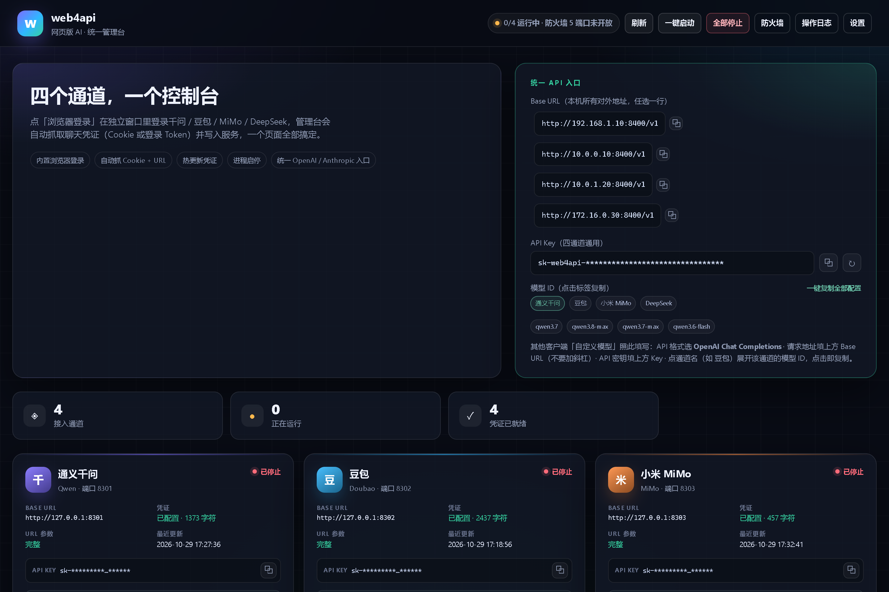
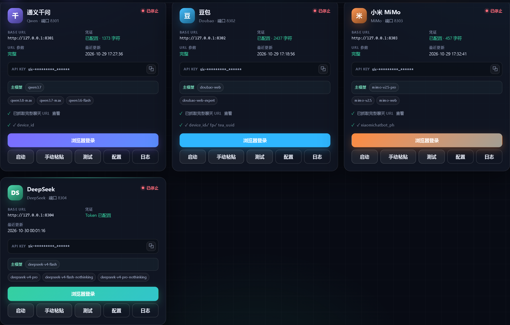

# web4api · 网页版逆向 API 本地中转

把 **DeepSeek / 千问 / 豆包 / 小米 MiMo** 四家网页版聊天逆向为本地 API 服务，
统一对外提供 **Anthropic 协议（`/v1/messages`）** 与 **OpenAI 协议（`/v1/chat/completions`）**，
支持流式输出、思考模式与工具调用，可直接接入 Claude Code、Codex、Cherry Studio、
LobeChat 等客户端。

> 🚀 **推荐用统一管理台**：运行 `python manager.py`，在网页里一键启动服务、
> 用内置浏览器登录千问/豆包/MiMo/DeepSeek 并自动抓取凭证（Cookie 或登录 Token）。
> 对外只需要一个 Base URL 和一把 Key。
 
> 💡 **为什么用网页版通道？**
> 1. **模型不掺水**：网页版用的是各平台完整能力的模型，不存在 API 分层降智——网页版不掺水，我们就不可能掺水；
> 2. **数据不泄露**：所有 URL 全部指向本地 127.0.0.1，流量只在你电脑和上游之间点对点传输，没有第三方中转，不存在数据泄露。

> ⚠️ **仅供个人学习研究，禁止商用。** 逆向访问网页服务可能违反对应平台用户协议，
> 存在账号被限流/禁言的风险（实测高频使用约禁言一天，之后自动解除），请务必使用一次性小号。上游改版可能导致服务失效。

---

## 管理台预览

下面两张图是统一管理台的真实界面（已脱敏，Key 与 IP 均打码）。

**首页顶部**：左边是项目简介与功能标签，右边「统一 API 入口」卡片列出本机所有对外 Base URL（含局域网 IP，点哪行复制哪行）、四通道通用 API Key，以及按通道分组的模型 ID（点通道名展开，点模型名复制）：



**四个通道卡片**：每张卡片显示运行状态、Base URL、凭证状态、API Key（点击复制）、主模型与模型 ID 列表；提供浏览器登录、启动/停止、手动粘贴、测试对话、配置与日志六个操作：



---

## 最快上手：统一管理台（推荐）

一个页面管理四个通道：启动/停止服务、浏览器登录抓凭证、查看日志、测试对话，
以及一个统一的 OpenAI / Anthropic API 入口。

### 1. 安装依赖

```bash
python -m venv .venv
.venv\Scripts\python.exe -m pip install -r requirements.txt
# 可选：如果系统没有 Edge/Chrome，再安装 Playwright 自带 Chromium
.venv\Scripts\python.exe -m playwright install chromium
```

> macOS / Linux 把 `.venv\Scripts\python.exe` 换成 `.venv/bin/python`。

### 2. 启动管理台

```bash
.venv\Scripts\python.exe manager.py
```

浏览器会自动打开 `http://127.0.0.1:8400/`。也可以手动加参数：

```bash
.venv\Scripts\python.exe manager.py --port 8400 --no-open
```

### 3. 浏览器登录，自动抓凭证

在千问 / 豆包 / MiMo / DeepSeek 卡片上点 **「浏览器登录」**：

1. 管理台用独立的浏览器资料目录打开对应平台登录页（优先系统 Edge，其次 Chrome，
   最后 Playwright Chromium），不会影响你日常使用的浏览器；
2. 在弹窗里完成登录（千问/豆包/MiMo 需随便发一条消息，DeepSeek 登录即可）；
3. 管理台自动抓取凭证（千问/豆包/MiMo 抓 **完整 URL、Cookie、User-Agent 和 URL 参数**，
   DeepSeek 抓登录 Token），并自动写入对应服务配置；
4. 如果服务已经在运行，会优先热更新，无需重启。

| 平台 | 抓取的聊天请求 | Cookie 关键字段 | URL 参数 |
|------|----------------|-----------------|----------|
| 千问 | `/api/v2/chat` 或 `/api/v1/chat` | `tongyi_sso_ticket` | `ut` |
| 豆包 | `/chat/completion` | `sessionid` | `device_id`、`fp`、`tea_uuid` |
| 小米 MiMo | `/open-apis/bot/chat` | `serviceToken` | `xiaomichatbot_ph` |
| DeepSeek | 无需抓包，登录后自动读 localStorage Token | — | — |

每个平台的浏览器资料存放在 `gateway/browser_data/<平台>/`，已被 `.gitignore` 排除。
切换账号时点「清除登录数据」即可。

### 4. 启动服务并接入客户端

在页面里点各卡片的 **「启动」**，或顶部 **「一键启动」**。

统一入口只有一个 Base URL 和一把 Key：

```
Base URL : http://127.0.0.1:8400/v1
API Key  : 管理台首页「统一 API 入口」里显示的那把
```

管理台按模型名自动路由：

| 模型名前缀 | 路由到 |
|------------|--------|
| `qwen*` / `qw-*` | 千问 qwen4api |
| `doubao*` / `db-*` | 豆包 doubao4api |
| `mimo*` | 小米 MiMo mimo4api |
| `deepseek*` | DeepSeek deepseek4api |

例如在 Claude Code 里：

```json
{
  "ANTHROPIC_AUTH_TOKEN": "<统一 Key>",
  "ANTHROPIC_BASE_URL": "http://127.0.0.1:8400",
  "ANTHROPIC_MODEL": "qwen3.7"
}
```

OpenAI 兼容客户端填 `http://127.0.0.1:8400/v1` 即可。

### 手动配置（不想用管理台）

仍然可以用向导逐个配置服务：

```bash
python setup_wizard.py qwen
python setup_wizard.py doubao
python setup_wizard.py mimo
```

Cookie 抓取的详细图文：[docs/cookie-guide.md](docs/cookie-guide.md)

**用其他平台（Gemini / Grok / Kimi…）？** 不需要等适配——按
[docs/generic-guide.md](docs/generic-guide.md) 的五步方法论自行接入，
文档里还附了一段可直接粘贴给你自己 AI 助手的协作提示词。

## 四个服务总览

| 服务 | 端口 | 上游 | 凭证方式 | 目录 |
|------|------|------|----------|------|
| **管理台** | 8400 | 统一入口 + 进程管理 | 统一 API Key | `gateway/` |
| **qwen4api** | 8301 | 千问 qianwen.com | Cookie（tongyi_sso_ticket） | `services/qwen4api/` |
| **doubao4api** | 8302 | 豆包 doubao.com | 完整 Cookie | `services/doubao4api/` |
| **mimo4api** | 8303 | 小米 MiMo Studio | 完整 Cookie（含 serviceToken） | `services/mimo4api/` |
| **deepseek4api** | 8304 | DeepSeek 网页版 | 浏览器登录 Token（本地 PoW 求解） | `services/deepseek4api/` |

所有服务默认只监听 `127.0.0.1`（本机），协议相同、只有端口不同。
也可以绕过管理台，直接访问各服务端口；四个服务的 `api_key` 可以在各自
`config.json` 里改成同一个值，一把钥匙通吃。

## 协议端点（四个服务通用）

| 端点 | 说明 |
|------|------|
| `POST /v1/messages` | Anthropic Messages（流式/非流式/工具调用） |
| `POST /v1/chat/completions` | OpenAI Chat（流式/非流式/工具调用） |
| `POST /v1/responses` | OpenAI Responses（Codex 用，qwen/doubao 支持，实验性） |
| `GET /v1/models` | 模型列表 |
| `POST /admin/cookie` | 热更新凭证：header `X-Admin-Key`，body `{"cookie": "..."}` |
| `POST /admin/credentials` | 热更新 Cookie + chat_url + URL 参数（管理台使用） |
| `POST /admin/shutdown` | 停止服务：header `X-Admin-Key`（管理台使用） |
| `python services/xxx.py --check` | 自检：配置 / Cookie / 上游连通性 |

管理台统一入口（`http://127.0.0.1:8400`）额外提供：

| 端点 | 说明 |
|------|------|
| `POST /v1/chat/completions` | OpenAI Chat，按模型名路由 |
| `POST /v1/messages` | Anthropic Messages，按模型名路由 |
| `POST /v1/responses` | OpenAI Responses，按模型名路由 |
| `GET /v1/models` | 聚合四个通道的模型列表 |
| `GET /api/overview` | 管理台状态（服务、凭证、浏览器） |
| `POST /api/login/{平台}/start` | 启动内置浏览器登录并抓取凭证 |

错误响应带结构化 `code` 字段：`cookie_missing` / `cookie_expired` / `rate_limited` /
`risk_control` / `upstream_error`，`message` 为中文处理指引。

## 模型表

### 千问（qwen4api）
| 模型名 | 上游 | 说明 |
|--------|------|------|
| `qwen3.7` | Qwen3.7-千问 | 综合，默认 |
| `qwen3.8-max` | Qwen3.8-Max | 旗舰/视觉 |
| `qwen3.7-max` | Qwen3.7-Max | 代码/复杂任务 |
| `qwen3.6-flash` | Qwen3.6-Flash | 快速 |

任意 `Qwen*` 新模型名自动透传；`config.json` 的 `extra_models` 可自定义映射。
**思考模式**：仅 `qwen3.7` 支持（免费版实测限制），模型名加 `-think` 后缀开启，如 `qwen3.7-think`。思考模式下模型对工具调用指令的遵从性显著提升，**Agent 重度工作建议直接用 `qwen3.7-think`**。

> ⚠️ **定位说明**：千问网页通道适合**聊天与轻量任务**。做 Agent 重度工作（Claude Code 连续工具调用）时响应慢且模型偶尔不遵从工具指令（服务内置三级自愈，但先天上限如此），重度工作建议用 `deepseek-web` / `doubao-web` / `mimo-web`。

### DeepSeek（deepseek4api）
`deepseek-v4-flash`（快）/ `deepseek-v4-pro`（强）及 `-nothinking`、`-search` 变体。

### 豆包（doubao4api）
| 模型名 | 说明 |
|--------|------|
| `doubao-web` | 豆包 快速 |
| `doubao-web-expert` | 豆包 2.1 Turbo 专家（256k 上下文） |

### 小米 MiMo（mimo4api）
| 模型名 | 说明 |
|--------|------|
| `mimo-v2.5-pro` | 开源性能旗舰（默认） |
| `mimo-v2.5` | 全模态理解 |

MiMo 的思考内容自动解析：Anthropic 输出为 `thinking` 块，OpenAI 输出为
`reasoning_content` 字段。

## 工具调用说明

各上游均无原生 function calling，本仓库通过 **提示词约定 + 解析还原** 模拟：
请求携带 `tools` 时，服务把工具定义注入提示词，解析模型输出中的
`<tool_call>{...}</tool_call>` 块并还原为标准 `tool_use` / `tool_calls`。
实测可驱动 Claude Code 完成文件读写与命令执行，但复杂任务的可靠性低于原生 API，
遇到失败重试一次通常即可。

## 接入 Claude Code

推荐使用管理台统一入口（模型名决定路由）：

```json
{
  "ANTHROPIC_AUTH_TOKEN": "<管理台统一 Key>",
  "ANTHROPIC_BASE_URL": "http://127.0.0.1:8400",
  "ANTHROPIC_MODEL": "qwen3.7"
}
```

也可以绕过管理台，直连单个服务（以千问为例）：

```json
{
  "ANTHROPIC_AUTH_TOKEN": "<qwen4api 的 api_key>",
  "ANTHROPIC_BASE_URL": "http://127.0.0.1:8301",
  "ANTHROPIC_MODEL": "qwen3.7"
}
```
上游改版导致解析失效时，`python tests/test_parsers.py` 会第一时间告诉你坏在哪。

**配置文件去哪了？** `config.examples/` 里的模板是"填空用的样例"：
向导（或你手动）会参照它们生成每个服务目录下的真实 `config.json`
（含你的 Cookie 和自定 API Key），这个真实文件被 `.gitignore` 排除，永不上传。

运行时还会生成一些临时文件（`service.log`、`__pycache__`），
均已被 `.gitignore` 排除。
想看各通道**当前真实可用性**（Anthropic+OpenAI 双协议、含工具调用），运行：
`python tests/check_protocols.py`

## 缺点与风险（必读，全是实测踩出来的）

| # | 缺点/风险 | 真实案例 |
|---|-----------|----------|
| 1 | **账号禁言**：逆向访问违反平台条款，高频使用会触发风控 | DeepSeek 小号在 Cursor 插件高频使用数小时后被禁言（连输入上传都被拒），实测约一天自动解除 |
| 2 | **速度慢**：网页管线每轮 5~20 秒，Agent 任务（几十轮工具调用）耗时分钟级 | 同任务官方 API 秒级完成 |
| 3 | **工具调用是模拟的**：靠提示词约定+解析还原，复杂任务可靠性低于原生 function calling | 偶发模型不调用工具直接文字回答（服务会自动重试一次） |
| 4 | **限流敏感**：豆包/MiMo 连发两三条即空流；千问会静默限流甚至弹滑块 | 千问小号连续测试后整晚返回空流，数小时自动解除 |
| 5 | **思考可见性差异**：qwen/doubao 上游不输出思考文本，只有 mimo/deepseek 有 | 千问思考模式仅 qwen3.7 支持，且简单问题不触发思考 |
| 6 | **无 SLA**：上游改版即全体失效，需要跟进更新 | 历史上此类开源项目平均存活周期以月计 |

缓解手段：多通道轮换（本仓库就是为此设计的）、服务内置限速器与自动重试、
`python tests/check_protocols.py` 一键体检各通道真实状态。

## 常见问题

| 现象 | 处理 |
|------|------|
| 连续返回空流 | 被限流了。服务会自动重试；仍失败请降低频率，并在网页上正常聊一句恢复 |
| 网页弹滑块验证 | 只是网页前端的验证，**不影响 API 通道**，手动拖一下即可 |
| 报 `cookie_expired` | 重新抓 Cookie，`/admin/cookie` 热更新或改 config 后重启 |
| 工具调用偶尔失败 | 模拟实现的固有局限，重试即可；重要任务建议官方 API |
| **账号被禁言/限制** | 真实案例：DeepSeek 账号在连续使用后触发了违反用户协议限制。处理：等待解除（通常几小时到几天）或更换小号；**这就是为什么必须用小号** |
| Codex 连不上 | Responses 端点为实验性，确认 base_url 以 `/v1/responses` 结尾 |
| 管理台打不开 / 端口被占用 | 管理台会自动换到下一个空闲端口，终端里会打印实际地址；也可以 `manager.py --port 8410` |
| 点「浏览器登录」没有窗口 | 确认用 `.venv\Scripts\python.exe` 启动且已安装 `playwright`；系统 Edge/Chrome 都没有时执行 `python -m playwright install chromium` |
| 登录后一直显示「等待发送消息」 | 在网页里真的发送一条消息；部分平台登录态 Cookie 要发消息后才完整。仍不行就点「清除登录数据」重登 |
| 统一入口返回 401 | 使用管理台首页显示的统一 Key；各服务自己的 Key 也可以 |
| DeepSeek 提示 token 无效/过期 | 管理台 DeepSeek 卡片重新点「浏览器登录」抓一次即可（一般 30 天左右一次） |

手动发布：

```bash
git init
git add .
git commit -m "web4api: 网页版逆向 API 本地中转（DeepSeek/千问/豆包/MiMo）"
git remote add origin https://github.com/<你的用户名>/web4api.git
git branch -M main
git push -u origin main
```

发布前最后检查：`services/*/config.json` 不在暂存区；`cookie*.txt` 已删除；
`.github_token` 不在暂存区。

## 免责声明

仅供学习交流，禁止商用。使用本项目产生的账号风险、数据风险与法律风险由使用者
自行承担。请尊重各平台服务条款，支持正式 API 才是可持续之路。License 见
[LICENSE](LICENSE)（MIT + 附加条款）。
